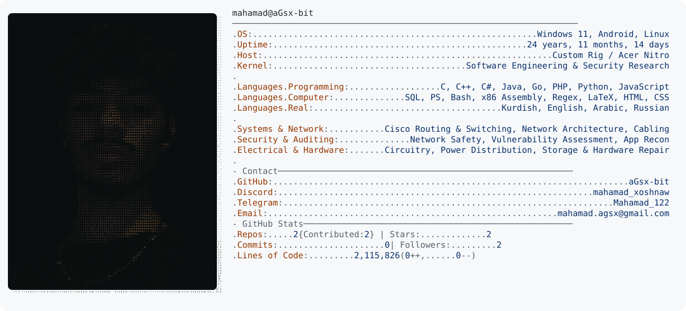

<a href="https://agsx-bit.github.io/">
  <picture>
    <source media="(prefers-color-scheme: dark)" srcset="./dark_mode.svg">
    
  </picture>
</a>

---

### Mahamad (`aGsx` / `@aGsx-bit`)

Self-taught developer and security researcher. I study how systems behave, test weak points, and build practical tools.

- **Website:** [agsx-bit.github.io](https://agsx-bit.github.io/)
- **Languages:** Java, PHP, Node.js, Python
- **Security & Recon:** Network safety, vulnerability assessment, OSINT
- **Contact:** [Telegram (@Mahamad_122)](https://t.me/Mahamad_122) · `mahamad.agsx@gmail.com` · Discord: `mahamad_xoshnaw`

### Public Repositories

- **[aGsx-sentinel](https://github.com/aGsx-bit/aGsx-sentinel)** — Autonomous LLM-powered penetration testing, vulnerability assessment, and security audit platform
- **[TelegramHunter](https://github.com/aGsx-bit/TelegramHunter)** — Multi-account Telegram OSINT toolkit for message search, entity enumeration, link discovery, and JSON export
- **[blackhole-ascii](https://github.com/aGsx-bit/blackhole-ascii)** — Pure-code 32,768-particle 3D gravitational lensing ASCII black hole simulation in Python (NumPy + Tkinter)
- **[snow-couple-ascii](https://github.com/aGsx-bit/snow-couple-ascii)** — 30 FPS pure-code procedural ASCII snowman & snowgirl animation in Python
- **[happy-birthday-ascii](https://github.com/aGsx-bit/happy-birthday-ascii)** — 30 FPS procedural ASCII birthday cake & typography renderer in Python
- **[aGsx-bit.github.io](https://github.com/aGsx-bit/aGsx-bit.github.io)** — Personal portfolio & project directory
